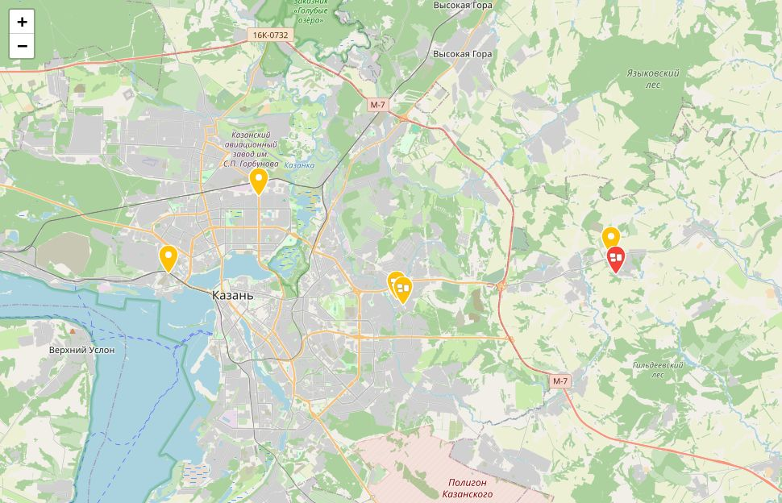
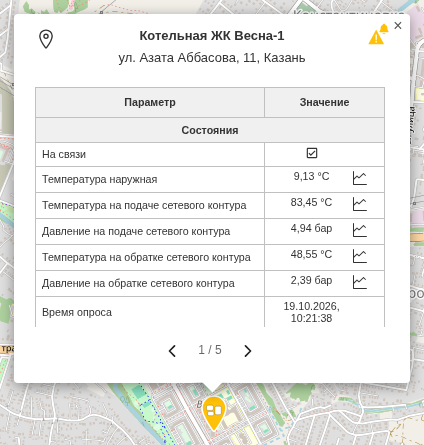

### Карта объектов

На карте отмечены все ваши объекты. Цвет метки показывает их состояние, а нажатие на метку — текущие показания.

#### Метки

| Цвет метки | Значение |
|---|---|
| **зелёный** | нештатных ситуаций нет |
| **жёлтый** | есть нештатная ситуация |
| **красный** | нет связи с объектом |

Котельная вместе со своими приборами учёта обозначена одной меткой со значком группы. Её цвет учитывает все устройства котельной: если на одном из счётчиков авария, метка станет жёлтой.

#### Окно объекта

Нажмите на метку — откроется окно с адресом объекта и его текущими показаниями. Значок графика рядом со значением открывает график этого параметра.

У котельной с приборами учёта окно сначала показывает саму котельную. Кнопки **‹** и **›** внизу окна переключают устройства (например, **«1 / 5»** — первое из пяти).

#### Управление картой

- Колесо мыши или кнопки **+** / **−** — масштаб, перетаскивание — сдвиг карты.
- **Долгое нажатие** на карту показывает все объекты сразу.
- В боковом меню, раздел **«Карта объектов»**: **«Все объекты»** — вся карта, ниже — переход сразу к нужному объекту. Если там только «Все объекты», включите список объектов в **Настройки → Вид → «Показывать все объекты карты»**.

#### Меню ⋮

- **«Обновить...»** — заново загрузить объекты и их состояние.
- **«Справка...»** — эта статья.
