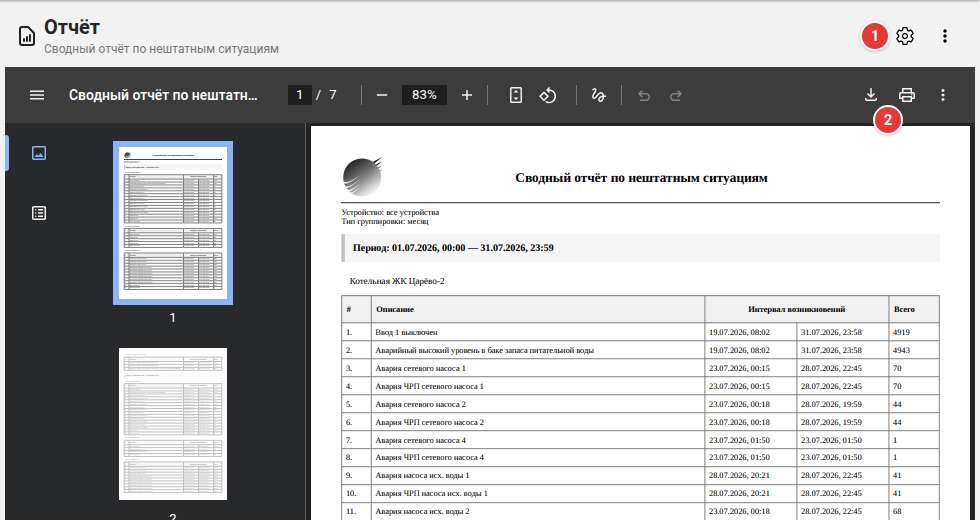
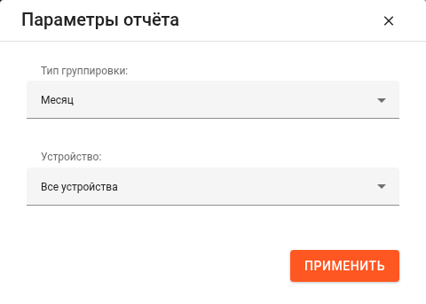

### Отчёты

Отчёты формируются по данным, сохранённым за выбранный период, и открываются прямо в приложении в виде документа PDF.

#### Какие бывают отчёты

- **«Нештатные ситуации»** (боковое меню → **«Отчёты»**) — сводный отчёт по нештатным ситуациям ваших объектов за период.
- **Отчёты по прибору**, например **«Ведомость учета»** счётчика, — с приборной панели прибора: меню **⋮ → «Отчеты...»**.

#### Работа с отчётом

1. Кнопка с шестерёнкой открывает **параметры отчёта**. После **«Применить»** отчёт формируется заново.
2. Кнопки панели просмотра PDF **сохраняют** документ на компьютер и **печатают** его.

**⋮ → «Обновить...»** — сформировать отчёт заново с теми же параметрами, например чтобы включить последние данные.

#### Параметры отчёта

- **«Нештатные ситуации»**: **«Тип группировки»** — сутки, неделя или месяц: на какие промежутки времени разбит отчёт; **«Устройство»** — все устройства или одно.
- **«Ведомость учета»**: **«Тип периода»** — текущий месяц, предыдущий месяц или за всё время.

Формирование отчёта за длинный период может занять несколько секунд.

#### Меню ⋮

- **«Обновить...»** — сформировать отчёт заново.
- **«Справка...»** — эта статья.
